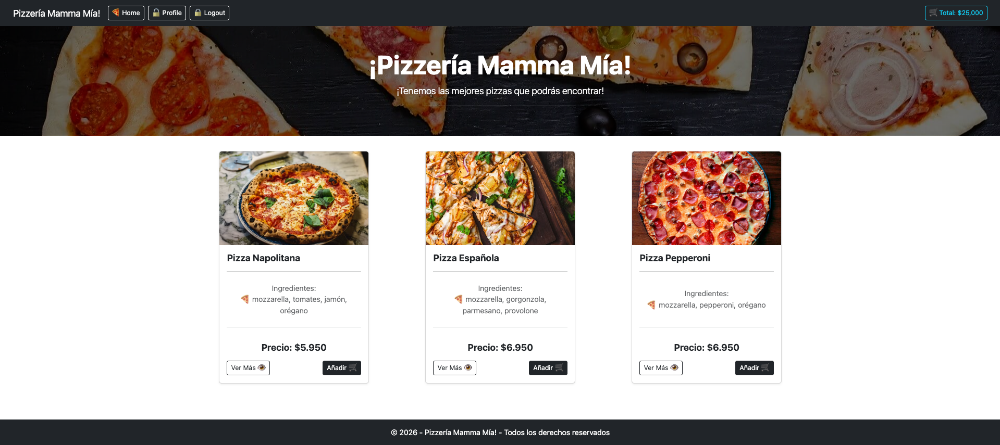
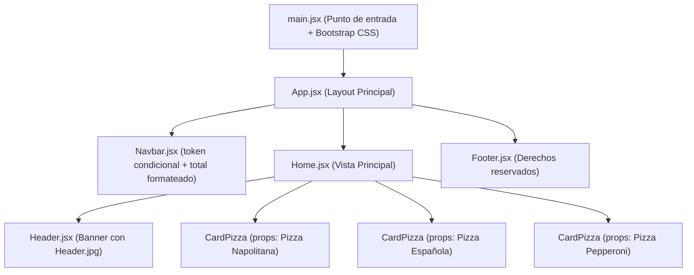

# 🍕 Pizzería Mamma Mía — Hito 1 (Introducción a React)

[](https://hito-1-pizzeria-mamma-mia-rho.vercel.app/)


Aplicación web para **Pizzería Mamma Mía!** desarrollada con **React + Vite**, correspondiente al **Hito 1 (Introducción a React)** de **Desafío Latam**. En esta primera etapa se construye la interfaz base de la tienda modularizando la vista en **componentes funcionales**, aplicando **renderizado condicional** en la barra de navegación, formateo de montos en **JSX** y **reutilización de componentes mediante `props`** para desplegar el catálogo inicial de pizzas.

---

## 🌐 Enlaces del Proyecto

- 🚀 **Live Preview (Vercel):** [https://hito-1-pizzeria-mamma-mia-rho.vercel.app/](https://hito-1-pizzeria-mamma-mia-rho.vercel.app/)
- 💻 **Repositorio en GitHub:** [https://github.com/jleival/hito-1-pizzeria-mamma-mia](https://github.com/jleival/hito-1-pizzeria-mamma-mia)

---

## 🖥️ Vista Previa del Proyecto



---

## 🎯 Objetivo del Hito 1

Aplicar los fundamentos esenciales de **React** para estructurar una aplicación web moderna a partir de componentes desacoplados y reutilizables:
1. Inicializar y estructurar un proyecto React con **Vite** e integrar estilos globales con **Bootstrap 5**.
2. Construir componentes independientes (`Navbar`, `Header`, `Home`, `CardPizza` y `Footer`).
3. Implementar lógica condicional en JSX utilizando operadores ternarios (`token ? ... : ...`) y formateo numérico (`toLocaleString()`).
4. Comunicar datos desde un componente padre (`Home`) hacia múltiples instancias de un componente hijo (`CardPizza`) a través de **`props`**.

---

## ✅ Requerimientos Cumplidos

| # | Requerimiento | Puntaje | Estado | Implementación |
| :---: | :--- | :---: | :---: | :--- |
| **1** | Crear un nuevo proyecto en React utilizando **Vite** y estructurar la vista principal en `App.jsx`. | **1 pt** | ✅ Cumplido | Configuración base en `src/main.jsx` con Bootstrap y disposición Flexbox (`Navbar`, `Home` y `Footer`) en `src/App.jsx`. |
| **2** | Crear `Navbar.jsx` mostrando opciones según `token` (*Profile/Logout* si `true`; *Login/Register* si `false`; *Home* y *Total* siempre visibles) y formatear `total`. | **3 pts** | ✅ Cumplido | Renderizado condicional con operador ternario y Fragments `<>...</>`, más `total.toLocaleString()` en `src/components/Navbar.jsx`. |
| **3** | Crear el componente `Footer.jsx` con el texto de derechos reservados y mostrarlo en `App.jsx`. | **1 pt** | ✅ Cumplido | Pie de página responsivo fijado al borde inferior en `src/components/Footer.jsx`. |
| **4** | Crear `Header.jsx` con la imagen de apoyo (`Header.jpg`) y textos de bienvenida, e invocarlo dentro de `Home.jsx`. | **1 pt** | ✅ Cumplido | Banner con superposición oscura (`linear-gradient`) e imagen local importada en `src/components/Header.jsx`. |
| **5** | Crear `CardPizza.jsx` recibiendo `props` (`name`, `price`, `ingredients`, `img`) y renderizar 3 pizzas en `Home.jsx`. | **4 pts** | ✅ Cumplido | Desestructuración de `props` y `.join(', ')` en `src/components/CardPizza.jsx`, instanciando *Napolitana*, *Española* y *Pepperoni* en `src/components/Home.jsx`. |

---

## 🏗️ Arquitectura de Componentes



### Detalle de los Componentes Principales

1. **`Navbar.jsx`:**
   - Define `const total = 25000` y formatea su salida visual mediante `${total.toLocaleString()}`.
   - Evalúa `token` con un operador ternario para alternar dinámicamente entre las opciones de usuario autenticado (`🔓 Profile`, `🔒 Logout`) y visitante (`🔐 Login`, `🔐 Register`), manteniendo siempre visibles `🍕 Home` y `🛒 Total`.

2. **`CardPizza.jsx`:**
   - Recibe las propiedades desestructuradas `{ name, price, ingredients, img }`.
   - Convierte el arreglo de ingredientes en texto legible usando `ingredients.join(', ')` y mantiene una altura uniforme entre tarjetas mediante Flexbox (`h-100` y `justify-content-between`).

3. **`Home.jsx` y `Header.jsx`:**
   - Integra el banner principal oscurecido con `linear-gradient` sobre `Header.jpg` y distribuye el catálogo en una grilla responsiva de 12 columnas (`Col md={4} sm={6} xs={12}`).

---

## 📂 Estructura del Proyecto

```text
hito-1-pizzeria-mamma-mia/
├── public/
│   └── favicon.svg
├── src/
│   ├── assets/
│   │   └── img/
│   │       ├── Header.jpg        # Imagen principal del banner superior
│   │       ├── escritorio.png    # Captura de vista en escritorio
│   │       └── movil.png         # Captura de vista responsiva móvil
│   ├── components/
│   │   ├── CardPizza.jsx         # Componente reutilizable de tarjeta mediante props
│   │   ├── Footer.jsx            # Pie de página
│   │   ├── Header.jsx            # Banner de bienvenida
│   │   ├── Home.jsx              # Contenedor del Header y grilla de pizzas
│   │   └── Navbar.jsx            # Barra de navegación con menú condicional
│   ├── App.jsx                   # Componente raíz (Navbar + Home + Footer)
│   ├── index.css                 # Estilos base y ancho uniforme de tarjetas
│   └── main.jsx                  # Renderizado en el DOM e importación de Bootstrap
├── package.json
└── vite.config.js
```

---

## ⚙️ Instalación y Ejecución Local

Sigue estos pasos para clonar y ejecutar el proyecto en tu entorno local:

1. **Clonar el repositorio:**
   ```bash
   git clone https://github.com/jleival/hito-1-pizzeria-mamma-mia.git
   cd hito-1-pizzeria-mamma-mia
   ```

2. **Instalar las dependencias:**
   ```bash
   npm install
   ```

3. **Iniciar el servidor de desarrollo:**
   ```bash
   npm run dev
   ```
   Abre en tu navegador la dirección indicada en la terminal (por defecto `http://localhost:5173`).

---

## 🛠️ Tecnologías Utilizadas

- **React 19** (Componentes Funcionales, JSX, Props, Fragments y Renderizado Condicional)
- **React Bootstrap & Bootstrap 5** (Grilla responsiva, Navbar colapsable, Cards y Botones)
- **Vite 8** (Entorno de desarrollo rápido y empaquetador de módulos)
- **Vercel** (Despliegue continuo en producción)

---

## 👨‍💻 Autor

Desarrollado por **Jorge Leiva** ([@jleival](https://github.com/jleival))  
Bootcamp **Desarrollo Full Stack JavaScript** — *Academia Desafío Latam*.
